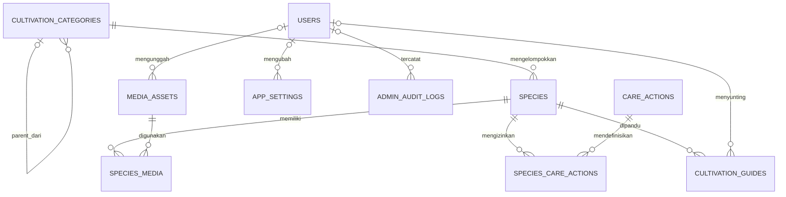
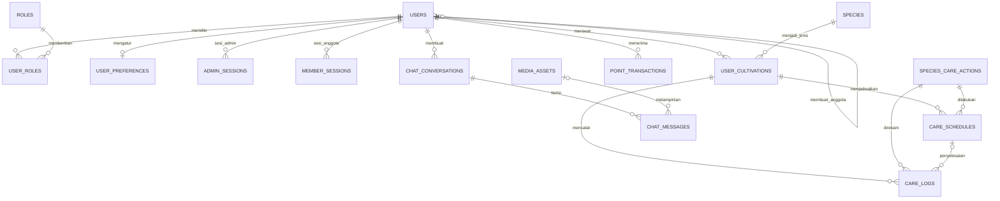

# Dewi Sri

## Aplikasi tertutup anggota KWT

Akun anggota dibuat hanya oleh administrator melalui **Kelola Anggota KWT** (`/admin/members`). Tidak tersedia pendaftaran publik atau akses tamu. Anggota masuk di `/login` menggunakan nomor HP domestik `08…`, username, atau email. Nomor tetap berupa string; spasi/tanda minus dan awalan `+62`/`62` dinormalisasi ke awalan `0`. Email dan username opsional bila nomor HP tersedia.

Administrator tetap dibuat melalui CLI dan masuk di `/admin/login`. Cookie HttpOnly `dewi_admin` dan `dewi_member`, tabel sesi, serta token CSRF keduanya terpisah. Anggota tidak dapat memakai API admin dan sesi admin tidak membuka kebun anggota.

Pengelola mengisi identitas dan kata sandi awal sedikitnya 15 karakter, lalu menyampaikannya secara pribadi. Akun baru secara default wajib mengganti kata sandi pada `/change-password`. Untuk anggota yang lupa kata sandi, gunakan **Atur Ulang Kata Sandi** di CMS; semua sesi lama dicabut. Belum ada pemulihan WhatsApp, SMS, atau email. Kata sandi anggota mendukung frasa 15–200 karakter tanpa aturan komposisi dan tanpa pemotongan atau pengubahan spasi.

Profil, preferensi, pilihan jenis dan progres Pet, jadwal, jurnal, hadiah harian, serta percakapan disimpan di MySQL. React menyimpan salinan di memori setelah pemeriksaan sesi. Server menentukan efek perawatan, tanggal Asia/Jakarta, poin, dan kepemilikan setiap rekaman. Foto pribadi disimpan di direktori privat server dan hanya tersedia lewat endpoint anggota yang memeriksa pemiliknya. Tanya Tani tetap panduan deterministik, tanpa penyedia AI eksternal.

**Skema:** pelengkap [`04_member_auth.sql`](docs/database/04_member_auth.sql) memperluas `users` dan menambah `member_sessions`, sehingga total menjadi **21 tabel**. Pada pemeriksaan 26 November 2026, MySQL lokal sudah memiliki perluasan tersebut. Bila belum tersedia di lingkungan lain: **phpMyAdmin → dewi_sri → SQL → Paste SQL → Go**. Bagian `ALTER TABLE` hanya dijalankan sekali. Jangan menjalankan ulang schema/seed atau skrip 04 pada database yang sudah diperluas. Aplikasi tidak menjalankan DDL otomatis.

Data prototipe lama di LocalStorage tetap dipertahankan tanpa dimuat, diunggah, atau dikaitkan dengan akun. Hanya cache katalog publik yang masih digunakan aplikasi aktif. Prosedur cadangan data lama, matriks pengujian, dan batas verifikasi tersedia di [`docs/member-auth-verification.md`](docs/member-auth-verification.md).

## Backend dan CMS internal

Backend Express/TypeScript tersedia di [`backend/`](backend/README.md), dengan autentikasi administrator melalui cookie HttpOnly, hash Argon2id, sesi MySQL, validasi Zod, CSRF, dan audit perubahan. CMS React tersedia di `/admin/login` dan `/admin`; navigasi aplikasi KWT tetap memakai `?screen=beranda` dan halaman yang sudah ada.

Tabel sesi admin berasal dari [`docs/database/03_admin_sessions.sql`](docs/database/03_admin_sessions.sql). Jangan ulangi pemasangan pada database yang sudah lengkap. Pelengkap anggota dan pemeriksaan kesiapan dijelaskan di atas; aplikasi tidak menjalankan DDL/seed atau membuat administrator otomatis.

Dari `backend`, jalankan `npm install`, sesuaikan `.env` lokal yang sudah ada, lalu `npm run admin:create` untuk membuat akun melalui terminal dan `npm run dev` untuk API di port 3001. Jalankan `npm install` dan `npm run dev` dari root dalam terminal lain untuk frontend di port 3000. Gunakan **http://localhost:3000/admin/login** untuk masuk. Perintah pengelolaan lain: `npm run admin:list`, `npm run admin:reset-password`, dan `npm run admin:disable`.

Katalog publik memuat kategori, Pet terbit, ilustrasi, tindakan, dan panduan dari MySQL melalui `/api/v1/catalog`. Jenis baru dapat muncul tanpa perubahan konstanta TypeScript. Cache katalog publik menjadi fallback dengan pemberitahuan jika katalog server tidak tersedia; akses pribadi tetap memerlukan sesi server. Ilustrasi bawaan berada di `public/assets/generated`; unggahan berada di `backend/storage/uploads` yang tidak ikut Git dan memerlukan penyimpanan persisten saat hosting.

Panduan langkah awal, API, CLI, keamanan, dan hosting tersedia di [backend/README.md](backend/README.md). Hasil pengujian dan batas verifikasi langsung tercatat di [docs/cms-verification.md](docs/cms-verification.md).

Frontend React dan TypeScript untuk merawat tanaman, ikan, dan ayam. Profil dan aktivitas pengguna dimuat dari API anggota; katalog publik memiliki cache lokal.

## Menjalankan

```sh
npm install
npm run dev
```

```sh
npm run lint
npm test
npm run build
```

## Struktur

| Lokasi | Tanggung jawab |
| --- | --- |
| `src/App.tsx` | Navigasi, penggabungan state, dan aksi aplikasi |
| `src/components/garden/` | Pemilih kegiatan, panduan, dan editor jadwal |
| `src/data/species.ts` | Nama, kelompok, dan aset setiap jenis |
| `src/data/care.ts` | Label dan aksi perawatan yang dipakai bersama |
| `src/features/consultation/localGuide.ts` | Jawaban teks dan panduan foto berbasis pilihan pengguna |
| `src/hooks/usePersistentState.ts` | State browser dengan penanganan kegagalan penyimpanan |
| `src/utils/gardenState.ts` | Validasi profil dan progres setiap spesies |
| `src/utils/careSchedule.ts` | Jadwal, migrasi format lama, dan penyelesaian harian |
| `src/utils/careJournal.ts` | Catatan kegiatan yang benar-benar ditekan pengguna |
| `src/utils/chatStorage.ts` | Validasi dan penyimpanan percakapan |
| `src/styles/` | Fondasi visual dan CSS per kelompok halaman |

`src/garden.css` hanya menggabungkan fondasi dan gaya halaman kebun. Halaman konsultasi, profil, serta onboarding mengimpor gaya masing-masing.

## Menambah jenis dan aset

1. Buka **Kelola Pet & Kategori** pada CMS, buat jenis dengan kategori yang sesuai, lalu atur tindakan, ilustrasi, dan status penerbitannya.
2. Lengkapi panduan pada **Panduan Budidaya**. Jenis baru dimuat dari API tanpa mengubah union TypeScript.
3. Untuk aset bawaan yang disertakan dalam kode, simpan di `public/assets/generated/` dan catat prompt pada `prompts.json`. Gunakan WebP ringan; sumber PNG boleh disimpan.

Progres dan jadwal disimpan pada rekaman budidaya per akun dan spesies. Pemilihan kembali jenis memakai rekaman yang sama; schema tetap mendukung beberapa rekaman budidaya sejenis kelak. Data prototipe lama tidak diimpor otomatis. Semua tanggal harian memakai Asia/Jakarta.

## Batas frontend dan titik integrasi

- Kamera/galeri melampirkan foto; panduan saat ini memakai jenis, kebutuhan, dan keterangan pengguna. Gambar belum dianalisis AI.
- Jawaban lokal terpisah di `localGuide.ts`, sehingga penyedia jawaban backend dapat disambungkan melalui lapisan ini dan state konsultasi tanpa mengganti tampilan.
- Panel cuaca menampilkan status belum terhubung. Lokasi profil sudah tersedia sebagai masukan layanan cuaca kelak.
- Jadwal berulang setiap hari. Tanda pengingat hanya tampil di beranda saat aplikasi dibuka dan diaktifkan; belum ada push notification.
- Profil, jadwal, jurnal, poin, dan percakapan dimuat dari MySQL setelah login; kegagalan backend ditampilkan dan tidak memberi akses luring ke data pribadi.
- Kunci AI/cuaca dan autentikasi produksi harus berada di backend. Jangan menaruh rahasia pada variabel `VITE_*` atau browser.

Hasil pemeriksaan frontend dan alur yang diperiksa tercatat di [docs/frontend-verification.md](docs/frontend-verification.md).

Arsitektur responsif aplikasi anggota dan CMS, matriks ukuran layar, hasil uji browser, serta batas pemeriksaan terbaru tercatat di [docs/responsive-ui-verification.md](docs/responsive-ui-verification.md).

---

## Rancangan backend dan database MySQL (tahap pengembangan)

> **Status:** API katalog publik, CMS, autentikasi admin dan anggota, serta persistensi pribadi tersedia. Skrip 03 dan 04 adalah perluasan manual. Bagian pemasangan schema/seed berikut hanya untuk database baru yang kosong, bukan database pengembangan yang sudah berisi data.

Tujuan desain: anggota KWT Dewi Sri dapat mencatat budidaya dan riwayatnya; admin pengembang dapat menambah kategori/jenis (misalnya **Ayam Jantan**), mengganti gambar sesuai kondisi, mengelola tindakan dan panduan; integrasi Tanya Tani nantinya melalui backend ke layanan RAG. API key dan password **tidak** disimpan dalam repository atau pengaturan publik.

### Skrip SQL untuk phpMyAdmin (tanpa fitur Import)

Database **`dewi_sri` sudah dibuat secara manual** melalui phpMyAdmin. Karena itu kedua skrip di bawah memakai `USE dewi_sri;` dan **tidak** menjalankan `CREATE DATABASE`.

| Urutan | Skrip | Isi |
| --- | --- | --- |
| 1 | [`docs/database/01_schema.sql`](docs/database/01_schema.sql) | **DDL:** 19 tabel, foreign key, unique key, indeks, dan tipe data |
| 2 | [`docs/database/02_seed.sql`](docs/database/02_seed.sql) | **DML:** 3 role, 6 kategori, 11 jenis budidaya, 8 tindakan, 33 hubungan tindakan per jenis, dan referensi 12 aset |

**Cara menjalankan:**

1. Jalankan Laragon, lalu buka **phpMyAdmin**. Pilih database kosong bernama **`dewi_sri`** pada panel sebelah kiri.
2. Buka file **`01_schema.sql`** dari tautan di atas, **salin isi SQL-nya** (bukan URL atau tampilan HTML GitHub), lalu buka tab **SQL** di phpMyAdmin. Tempel seluruh skrip dan tekan **Go/Kirim**.
3. Pastikan **19 tabel** terdaftar di tab **Structure/Struktur**. Skrip DDL juga mengakhiri proses dengan `SHOW TABLES;`.
4. Buka file **`02_seed.sql`**, salin seluruh isinya, lalu tempel pada tab **SQL** di database yang sama dan tekan **Go/Kirim**.
5. Hasil awal yang diharapkan: **6 kategori, 11 jenis Pet, 8 tindakan dasar, 33 hubungan jenis–tindakan, 12 referensi media, 12 hubungan jenis–media**. Tabel aktivitas pengguna dan percakapan masih kosong, begitu pula konten panduan hingga dimigrasikan/ditambahkan.
6. Jika muncul kesalahan, **catat pesan kesalahan dan perintah yang gagal**, kemudian perbaiki perintah tersebut; jangan langsung melakukan reset database.

Skrip ditujukan untuk **MySQL 8.0+/8.4, InnoDB, UTF-8 (`utf8mb4`)**. Laragon dapat menggunakan mesin/versi database berbeda (misalnya MariaDB); cek versinya dengan `SELECT VERSION();` dan uji kompatibilitas bila berbeda. SQL disediakan agar **di-copy–paste dari tab SQL**, bukan melalui menu **Import**.

Kedua skrip **tidak** menjalankan `DROP TABLE`, `DELETE`, atau `TRUNCATE`. DDL menggunakan `CREATE TABLE IF NOT EXISTS`; seed bersifat **no-op pada kunci unik yang sudah ada**, sehingga pengulangan tidak otomatis mengubah data CMS yang telah diedit. **Catatan:** `IF NOT EXISTS` tidak mengubah struktur tabel yang telanjur ada, dan bukan mekanisme migrasi skema.

### ERD — A. Katalog budidaya dan CMS



`cultivation_categories` menyimpan hierarki **Tanaman → Sayuran/Buah/Biji-bijian**, serta kategori **Ikan** dan **Ayam**. `species` adalah **master katalog**, bukan Pet pribadi. `species_media.state_key` dapat mengacu ke `normal`, `wilted`, `sick`, dan keadaan tambahan dari CMS; `species_care_actions.slot_key` sementara mempertahankan kompatibilitas `action1`–`action3` frontend.

### ERD — B. Pengguna, perawatan, poin, dan Tanya Tani



Satu anggota dapat membuat **lebih dari satu `user_cultivations`** untuk jenis yang sama (misalnya dua area kangkung). Satu kegiatan harian tercatat di `care_logs`; penyelesaian jadwal ditentukan dari `schedule_id` + `local_date`. `point_transactions` mencatat hadiah poin terpisah dari total kegiatan yang menentukan peringkat. Chat dan metadata hasil RAG disimpan di MySQL, sedangkan model dan vector store dapat dikelola oleh penyedia RAG terpisah.

### Inventaris 21 tabel setelah perluasan manual

| Kelompok | Tabel |
| --- | --- |
| Akun dan hak akses (4) | `users`, `roles`, `user_roles`, `user_preferences` |
| Master budidaya dan konten CMS (7) | `cultivation_categories`, `species`, `media_assets`, `species_media`, `care_actions`, `species_care_actions`, `cultivation_guides` |
| Aktivitas anggota (4) | `user_cultivations`, `care_schedules`, `care_logs`, `point_transactions` |
| Konsultasi (2) | `chat_conversations`, `chat_messages` |
| Pengaturan dan jejak admin (2) | `app_settings`, `admin_audit_logs` |
| Sesi terpisah (2) | `admin_sessions`, `member_sessions` |

### Aturan perubahan struktur selama PKM

- **Perubahan data** (mis. nama Pet, status panduan, gambar) dilakukan memakai `INSERT`, `UPDATE`, atau CMS setelah terbangun. Menjalankan ulang seed **bukan** cara memperbarui baris lama.
- **Perubahan struktur** dilakukan melalui perintah **`ALTER TABLE`** baru pada tab SQL dan dicatat dalam skrip perubahan berikutnya, misalnya:

  ```sql
  -- Contoh PENAMBAHAN kolom, hanya dijalankan sekali apabila belum ada.
  ALTER TABLE species ADD COLUMN harvest_days INT UNSIGNED NULL;
  ```

- Hindari `DROP TABLE`, `TRUNCATE`, atau penghapusan foreign key tanpa menilai dampaknya. Cadangkan data sebelum migrasi yang berisiko meskipun masih lokal.
- `species_care_actions.species_id` harus sesuai dengan `user_cultivations.species_id` pada jadwal/jurnal; **backend wajib memvalidasi kesesuaian tersebut** karena foreign key masing-masing saja belum menjamin keduanya sejenis.
- Seluruh kunci rahasia RAG/cuaca disimpan di **environment server Node.js** (misalnya `.env` yang di-`gitignore`), bukan di `app_settings`, `VITE_*`, atau browser.
- Metadata gambar disimpan di `media_assets`, sedangkan file fisiknya di penyimpanan server. Aset katalog bersifat publik; foto konsultasi pribadi harus mempunyai kontrol akses.
- Data lama `localStorage` dipertahankan tanpa dimuat ke akun; verifikasi pemilik diperlukan sebelum migrasi yang dibantu pengembang. Akun administrator diprovisi melalui CLI; **tidak ada password atau akun admin dummy di seed**.
- Perubahan jenis Pet dari CMS kini dibaca oleh katalog dinamis. Slug menjadi identitas progres lokal; pertahankan slug setelah publikasi. Pet yang diarsipkan tidak ditawarkan untuk pilihan baru, sementara riwayat dan referensi tetap disimpan.
