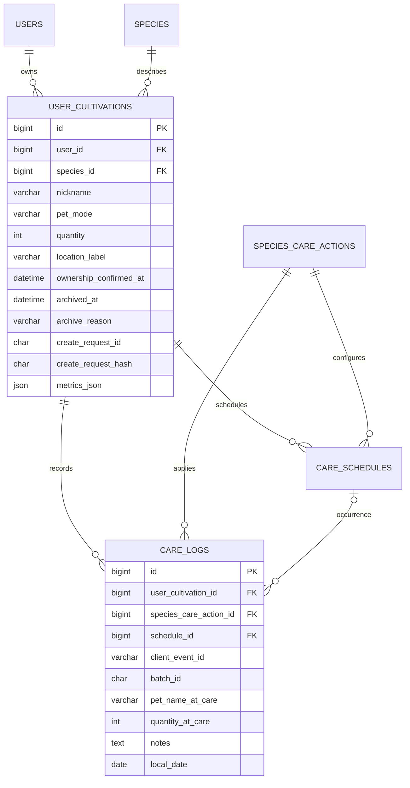

# Multi-Pet implementation and verification

27 November 2026, Asia/Jakarta. This concept remains provisional pending PKM supervisor review.

## Implemented behavior

Catalog `species` describes a shared kind of cultivation. An owned Pet is one `user_cultivations` record, identified everywhere by its string BIGINT ID. Multiple members and multiple Pets of the same species are independent. Individual mode always represents one plant/animal; group mode represents 1–1,000,000. Quantity describes the current physical group; it never multiplies effects, activities or points.

New accounts have no Pets. Category changes, selection, opening care, and scheduling never create cultivation records. Pet creation is an explicit form with ownership confirmation, a published species in an active category tree, required nickname, mode, quantity and optional location. Names may repeat. Species cannot be changed after creation; rename, mode/quantity and location edits preserve identity, metrics and history.

The member workspace is in `src/features/pets/`. `MemberGarden` reads server-owned arrays and selected ID maps. `PetVisual` receives an owned DTO and renders its species media, with a neutral named category symbol when no asset exists. It does not invent ownership, modify catalog globals, or fall back to another species' image. Legacy utility validators remain for historical prototype tests; they are not the active owned-state store. The unused species-selection React screens were removed.

Pet Saya (`/?screen=pet_saya`) supports category, search and Active/Archive views, details, creation, review, editing and archive/restore. It remains under Beranda in the four-destination navigation. Beranda displays the selected nickname, species, mode, physical quantity, location and honest empty states. Category tabs switch category; Pilih Pet selects an owned record.

## Schema and migration

The actual local `dewi_sri` database was inspected read-only. Result: **21 tables**, existing `uq_care_logs_client_event` present, **all eleven SQL 06 fields absent**, creation unique key and mode/quantity CHECK absent. No schema changes, seed/reset, member writes, or test accounts were made in that database.

Apply [`database/06_multi_pet_management.sql`](database/06_multi_pet_management.sql) **once manually** using phpMyAdmin → dewi_sri → SQL → paste the file contents → Go. It changes two existing tables and creates no new tables. Do not rerun 01/02 or already applied 03/04/05. If a previous manual run partially succeeded, inspect Structure/Indexes and complete only missing ALTER clauses; do not blindly rerun the whole file.

If phpMyAdmin reports **#1044 access denied to `information_schema`**, the statement is targeting the system metadata database rather than the application database. Select **dewi_sri** in the left sidebar, open its SQL tab, and paste the entire current file including `USE`. Both `ALTER TABLE` statements now explicitly name `dewi_sri`, so their target does not depend on the selected database. Do not grant write privileges on `information_schema`. The read-only check after this error still found all SQL 06 fields absent; the migration itself was not executed during this fix.

| Table | Additions |
| --- | --- |
| `user_cultivations` | `pet_mode`, `quantity`, `location_label`, `ownership_confirmed_at`, `archived_at`, `archive_reason`, `create_request_id`, `create_request_hash` |
| `care_logs` | `batch_id`, `pet_name_at_care`, `quantity_at_care`, index `idx_care_logs_batch` |
| Constraints | `uq_uc_create_request (user_id,create_request_id)`, `chk_uc_mode_quantity`; existing `uq_care_logs_client_event (user_cultivation_id,client_event_id)` retained |

No unique `(user_id,species_id)` key is introduced. Nullable creation UUID/hash fields preserve historical rows. Existing ownership timestamps intentionally remain NULL; migration does not claim their real ownership. Old care quantities remain NULL rather than falsely copying current quantities into history.

Run from the backend directory:

```powershell
npm run schema:multi-pet
```

This command queries schema metadata and prints readiness, table count, field definitions and constraint names/types. It does not select member content or print credentials. `GET /api/v1/health/multi-pet-schema` also reports readiness without applying anything. Runtime readiness verifies fields and the three expected constraints. Missing SQL 06 causes member Pet features to show unavailable and Pet mutations to return 503 `MULTI_PET_SCHEMA_NOT_READY`. General chat, profile, authentication and public CMS catalog are kept separate from this feature requirement. Deployment to a different MySQL/MariaDB version needs its own compatibility check.



The table inventory stays **21**: accounts/roles/preferences (4), catalog/media/actions/guides (7), cultivations/schedules/logs/points (4), conversations/messages (2), settings/audit (2), admin/member sessions (2). The full relationship inventory remains in the root README.

## Transactions, retries and history

All Pet, care and schedule writes use the existing `auth.mutate` transaction: lock the ordinary member's `users` row with `FOR UPDATE`, then revalidate the session/status/password-change requirement. This serializes mutations for that member across Node processes. Catalog reads and CMS action effects determine accepted operations; client-supplied owner, metrics, points, visual state and species changes are rejected. IDs remain strings in DTOs, preferences, React keys and requests.

Creation stores a UUID and SHA-256 canonical parsed payload. The same UUID/payload returns the original record before rechecking catalog availability; changed payload returns 409. The existing per-user UUID unique constraint remains the database backstop. The form reuses its request UUID when retrying an unchanged failed draft.

Individual care targets one confirmed active owned ID. Rawat Bersama targets a nonempty distinct list of confirmed active owned IDs of exactly one species and a stable `care_actions.id`, never a display label. `BULK_CARE_MAX_PETS` defaults to 50 (configurable 1–100). The UI shows both selected Pet count and represented physical quantity, and requires confirmation of the real action. One group receives one metric update and one care log regardless of quantity.

Before mutation, event replay lookup scans all of that member's logs for `client_event_id` or `batch_id`. Notes retain a canonical operation/targets/action fingerprint. Replays with changed targets, actions or operation return 409. An unchanged successful replay returns original affected IDs/quantity even after rename, quantity changes, archive, or catalog changes. New bulk logs share the request UUID in both event and batch fields. All targets and the action are validated before effects; an error during any write rolls back the entire batch. There are no external AI/network calls in this transaction.

Manual or bulk care completes at most one matching enabled pending schedule per Pet, in stable schedule ID order. It does not mark unrelated actions/Pets complete. Schedule completion checks the Jakarta occurrence even when retry UUIDs differ. Further explicitly recorded physical care can create another log after that occurrence is complete. Disabled schedule rows and prior completions remain available. Schedules are arrays keyed by schedule ID and cultivation ID, not slug-keyed maps. Adding another time creates another schedule row, including for the same Pet/action; editing targets the original schedule ID.

The journal first pages 20 logical activity keys, then fetches all rows belonging to each selected batch. A batch is never split by page size. Total counts and “loaded” counts are separate. New entries use immutable name and quantity snapshots; legacy missing quantities display “Jumlah saat perawatan tidak tercatat.” Data from another member never enters the page or totals. A detail view can filter the loaded activities to the selected Pet; load-more remains available when older activities exist.

Rank contribution = distinct non-null batches + rows without a batch. Historical rows retain their previous contribution. Thresholds remain 3/6/10/20; daily reward remains 5 ledger points per Jakarta day with the previous uniqueness/streak policy. Creating, reviewing, renaming, restoring and changing quantity grant no activity or points.

Archive sets status/timestamp/reason, disables schedules and resolves selected-ID fallbacks in the same transaction. It never deletes histories. Restore keeps IDs/metrics/logs and leaves schedules disabled. An existing Pet may be restored even when its catalog species has been archived; that species remains unavailable for new creation. Legacy unconfirmed rows retain their original IDs/metrics/schedules/logs and must be reviewed in place before new care/scheduling.

## Administrator and AI boundaries

CMS terminology is Katalog Pet & Kategori / jenis budidaya. The dashboard separates catalog counts from owned member Pet counts. Member cards show active, individual, group, archive and unconfirmed counts. Lihat Pet Anggota opens a read-only 20-row page for an ordinary member only. The DTO contains nickname, species/category, mode/quantity, location and status/confirmation; no private conversations, photos, password material or metric-edit controls. Member routes cannot use admin cookies and admin routes require independent admin authentication.

Gemini provider routing, fallback keys, sessions, private WebP media, rate limits and durable chat turns remain in place. The local nickname/species label may be displayed in Tanya Tani. Photo context passes only an existing optional species identifier available in the consultation selector; an unavailable archived species is omitted. Nickname, location, metrics and care history are not automatically inserted into external prompts. General chat works with no Pets. AI consent and demo-ID allowlist requirements are not reintroduced. The creation/review checkbox confirms real Pet ownership only.

`PetVisual` is a static rendering boundary suitable for a later layered renderer. No new generated assets, animation editor, 3D, IoT, live weather, additional AI provider or RAG implementation was added.

## Automated and visual evidence

The results below include the final verification runs. All new mutation tests use mocks/in-memory transactional fixtures. They do not exercise real MySQL locking/rollback or apply SQL 06 to a developer database.

| Check | Result |
| --- | --- |
| Frontend TypeScript, unit tests, production build | Passed; 20 unit tests |
| Backend TypeScript, unit/mock integration tests, build | Passed; 60 tests, 0 failures |
| Chrome browser suite | 79 distinct scenarios passed across full suite and focused reruns; details below |
| Actual MySQL | Read-only metadata verified; 21 tables; SQL 06 missing |
| Isolated MySQL mutation tests | Not run |
| Live external Gemini | Not called for this task; routine regression uses mocks |

Local frontend and API ran concurrently: HTTP 200 from port 3000, API health and database health on port 3001; the Multi-Pet readiness endpoint returned `ready:false`. Read-only constant CTE queries verified logical batch grouping/count syntax under the local MySQL **8.0.30** `ONLY_FULL_GROUP_BY` / strict SQL modes (three constant rows grouped as two activities). These checks inserted no records and do not constitute post-migration integration testing.

The first full browser run passed 76/77; its failure was an obsolete species-picker search assertion, updated for the searchable owned-Pet picker. The next full run with two workers passed 77/78; the 341 px multi-navigation screenshot scenario exceeded its 30-second total test budget. That scenario passed serially after increasing its total budget to 60 seconds, alongside the newly added missing-image fallback scenario (2/2). Thus all 79 distinct scenarios passed across these runs; this is not a claim of a single 79/79 full run. Existing drag, keyboard, reduced-motion, CMS publishing, closed authentication and Gemini mock regressions passed in the full runs.

Backend coverage includes empty ownership, same-species identities, large string IDs, input validation, creation replay/conflict, dynamic CMS species, legacy confirmation, selection migration, metric isolation/clamping, global care replay, bulk rollback for invalid/foreign/archive/unconfirmed/mixed/action/failure cases, overlapping serialized requests, schedule occurrence semantics, restore behavior, full-batch journal pagination, snapshots, logical counts, admin read-only filtering and auth/AI regressions. In-memory concurrency tests model serialization; they are not evidence of MySQL lock contention behavior.

Browser checks cover widths **320, 341, 360, 390, 430, 768, 1024, 1366, 1440, 1920**, including empty and populated gardens, long names/locations, form/detail/bulk sheets, keyboard dismissal, navigation, failed save/retry, legacy review, archive/restore, schedules, grouped journal and unchanged AI flows. Existing broader viewport/composer/auth/CMS/drag/reduced-motion checks remain. Viewports are Chrome simulations, not physical Samsung/iPhone/Pixel device certification. Screenshots are ignored artifacts in `.artifacts/multi-pet-review/`; selected phone/tablet/desktop renders were visually inspected. Font enlargement and horizontal overflow are checked by browser assertions.

Visual direction follows DESIGN.md: ENERGY 2 / RHYTHM 2 / MOTION 1, existing leaf green, warm paper, static cultivation illustrations and meaningful category/care icons. Form/list surfaces separate editable records from physical quantity. The existing bottom-sheet entrance/drag/focus behavior is reused; no decorative motion is added. The quality review checks native labels, visible focus, touch targets, honest disabled/empty/error/success states, wrapping and navigation clearance.

Calculated contrast for new text pairings: leaf green `#006A3E` on `#FFFEFA` 6.65:1, secondary `#58685B` on `#E8F4E9` 5.23:1, and main `#2B1704` on `#FFF8F5` 16.30:1. Other checked new green/paper combinations exceeded 4.5:1. This calculation does not claim a full assistive-technology audit.

### Form preview refinement

The quantity input is now shown only in group mode. Individual creation, editing and legacy review still submit quantity one. A static preview follows the selected catalog illustration, draft nickname, mode and physical quantity; editing uses the existing Pet's species and visual state. The renderer accepts visual data without requiring a fabricated owned ID. Catalog species without media retain a correctly named neutral preview. No animation or new illustration was added.

For this refinement, frontend TypeScript and production build passed, along with seven new form browser cases and three existing creation/edit/archive, legacy-review and missing-image regression cases. Screenshots at 320, 390, 768 and 1440 px were captured; the 320 and 1440 px renders were visually inspected. Enlarged text and keyboard dismissal also passed. Preview text contrast across the three category backgrounds is at least 4.97:1. These focused checks used browser fixtures and made no live database writes or external AI calls.

## Windows startup

Keep the existing `backend/.env`, MySQL credentials and Gemini keys. Start MySQL in Laragon, apply only the missing migration manually, and use two PowerShell terminals:

```powershell
# Terminal 1: API
Set-Location 'E:\College\Telkom University\Associate Degree of Information Systems\Projects\Virtual Assistant Dewi Sri\pkm_tim_7_2026\backend'
npm install
npm run schema:multi-pet
npm run dev
```

```powershell
# Terminal 2: frontend
Set-Location 'E:\College\Telkom University\Associate Degree of Information Systems\Projects\Virtual Assistant Dewi Sri\pkm_tim_7_2026'
npm install
npm run dev
```

Open `http://localhost:3000/login` as an existing member, or `http://localhost:3000/admin/login` as an administrator. API defaults to `http://127.0.0.1:3001`; Vite proxies `/api`. Do not use the API port as the member interface. Keys remain only in `backend/.env`: `GEMINI_API_KEY` and `GEMINI_API_KEY_FALLBACK`.

Reproduce checks without touching the developer database:

```powershell
# Repository root
npm run lint
npm test
npm run build
$env:PLAYWRIGHT_CHANNEL = 'chrome'
npm run test:browser
Set-Location backend
npm run typecheck
npm test
npm run build
```

## Manual verification after SQL 06

These are instructions for the developer, not a claim that live account writes were performed.

1. Confirm `npm run schema:multi-pet` returns `ready: true` and 21 tables. Check existing IDs/history remain.
2. Sign in to a new member account created through CMS. Confirm all categories start empty; switching categories and opening schedules creates nothing.
3. Add “Sawi Depan” and “Sawi Belakang” of the same species, individual quantity one, with different locations. Verify distinct cultivation IDs and refresh persistence.
4. Add “Kandang Belakang”, group quantity twelve; add two individual chickens. A group quantity of one is also valid; zero, decimals and individual quantity two are rejected.
5. Open a legacy Perlu konfirmasi Pet, review its name/mode/quantity/location and confirm ownership. Check ID, metrics and historical schedule/log references remain unchanged and no points/activity are awarded.
6. Use Pilih Pet to switch between same-species records. Care for only one after actually performing the action; verify only its metrics/journal change.
7. Use Rawat Bersama for the three chicken records: three selected Pets, fourteen ekor. Confirm the physical action and save. Check three logs share one batch UUID, quantity effects are not multiplied, and rank count increases by one.
8. Simulate a network failure after a successful request using DevTools; retry the same request UUID/payload. Check no second effects/logs. Reuse that UUID with changed targets/action through an API client: expect 409. Use test data in an isolated environment for failure/concurrency injection.
9. Set separate schedules for Sawi Depan and Sawi Belakang. Complete one and refresh; the other remains pending. Manual/bulk care completes only one relevant pending occurrence. Complete the same occurrence again with another request UUID: no extra occurrence log.
10. Rename Kandang Belakang and change quantity to ten. Open the previous batch: its original nickname and twelve-ekor snapshot remain. Historical rows without quantity must show unknown.
11. Create more than twenty activities and load more journal pages. Each batch remains intact, totals match logical activities, and no other member's records appear.
12. Archive a selected Pet with enabled schedules. Verify schedules disable, selection falls back to another active owned Pet or an empty state, and histories remain. Restore: same ID/metrics/history; schedules still disabled until manually enabled.
13. Archive a catalog species in CMS. Existing Pet details keep the correct species/assets; Add Pet no longer offers it. Restoring an owned archived Pet remains possible without republishing the species.
14. Add and publish a new species with actions/media in CMS. Add a member Pet of that species without changing TypeScript constants. Missing media should render a named neutral placeholder.
15. In CMS Members, open Lihat Pet Anggota, search/page members and page their Pets. Confirm counts and read-only fields; there are no care/metric overrides or consultation/media views.
16. Switch between two member accounts and reload. Check owned selections/schedules/journal are isolated. Recheck member/admin session separation, password-change and disabled-account behavior.
17. Use Tanya Tani with no Pets and with photo species context. Verify the AI label and per-answer provider metadata remain, with no consent gate; nickname/location/metrics/history are not automatically sent. A real Gemini test consumes quota and was not performed during this task.
18. Repeat the main form/care/bulk/archive/schedule flows in Chrome device emulation at the listed widths, enlarged text, keyboard-only and reduced motion. Check drag-down dismissal and full access to the final form button when the keyboard is open.

## Limits and decisions for review

The code and mocks are reviewable before manually applying SQL 06. End-to-end MySQL mutation/locking behavior and migrated real legacy records still require the developer's manual/isolated verification. Browser checks simulate devices; physical device keyboards and assistive technology were not certified. Groups represent one shared care state, not an inventory of every animal/plant or quantity history independent of care snapshots. Pet nicknames need not be unique. Quantity edits affect current representation only; historical care snapshots remain immutable.

PKM review should confirm the terms Pet/individual/group, whether these group boundaries match members' real work, the one-activity-per-batch rank policy, physical action confirmation wording, legacy ownership review, archive reasons/restoration of unpublished species, quantity/selection limits and what read-only member monitoring administrators actually need. Static visual indicators remain educational care records, never a real health diagnosis. Layered 2D animation and real inventory tracking are later decisions.
